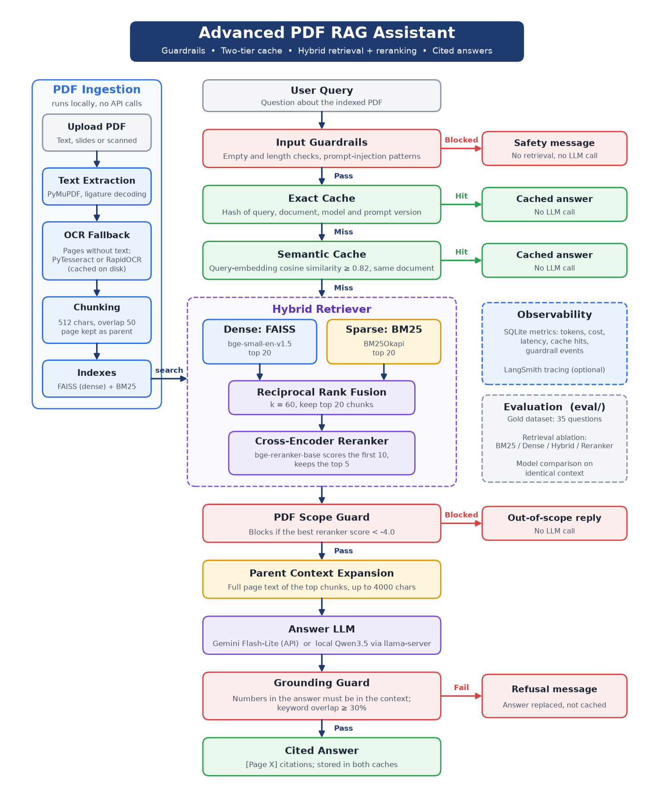

# Production-Grade Advanced PDF RAG Assistant (`pdf_rag_bot`)

A complete, production-ready Advanced Retrieval-Augmented Generation (RAG) system with dual-tier response caching, cost observability, production security guardrails, 100% local PDF scanning, and LangSmith telemetry. Capable of ingesting arbitrary PDF documents (including scanned pages, slide decks, diagrams, tables, and academic lecture notes) with strict cited grounding, sub-second cached responses, and zero-cost cached generation. It runs on the Gemini API or on a local Qwen3.5 model through `llama-server`, and ships with a gold-dataset evaluation study.

---

## 🏛️ System Architecture



> 📖 For comprehensive technical specifications, deep-dive component descriptions, and subsystem flows, see **[docs/ARCHITECTURE.md](docs/ARCHITECTURE.md)**.

```
                                USER QUERY
                                    │
                                    ▼
                         ┌────────────────────┐
                         │   SESSION MEMORY   │  Follow-up + last 3 turns ──► standalone question
                         │ (Follow-up Rewrite)│  (skipped on the first question of a chat)
                         └──────────┬─────────┘
                                    │
                                    ▼
                         ┌────────────────────┐
                         │  INPUT GUARDRAILS  │ ── Blocked ──► Return Safety Block Message
                         │ (Length, Injection)│
                         └──────────┬─────────┘
                                Pass │
                                    ▼
                         ┌────────────────────┐
                         │    EXACT CACHE     │ ── Hit ──► Return Cached Answer (0ms LLM, $0)
                         └──────────┬─────────┘
                                Miss │
                                    ▼
                         ┌────────────────────┐
                         │   SEMANTIC CACHE   │ ── Hit ──► Return Cached Answer (0ms LLM, $0)
                         │  (Cosine >= 0.82)  │
                         └──────────┬─────────┘
                                Miss │
                                    ▼
                             HYBRID RETRIEVER
                      ┌──────────────┴──────────────┐
                      ▼                             ▼
               Dense FAISS Index             Sparse BM25 Index
            (BAAI/bge-small-en-v1.5)           (BM25Okapi)
                      │                             │
                      └──────────────┬──────────────┘
                                     │
                      [Reciprocal Rank Fusion (RRF k=60)]
                                     │
                                     ▼ (Top 20 Fused Candidates)
                          CROSS-ENCODER RERANKER
                          (BAAI/bge-reranker-base)
                          (Scores the First 10)
                                     │
                                     ▼ (Top 5 Reranked)
                         ┌────────────────────┐
                         │  PDF SCOPE GUARD   │ ── Blocked ──► Out-of-Scope Response
                         │ (Reranker >= -4.0) │
                         └──────────┬─────────┘
                                Pass │
                                     ▼
                          PARENT CONTEXT EXPANSION
                    (Full Page Text, up to 12000 chars)
                                     │
                                     ▼
                           GENERATION LLM & PROMPT
                (Gemini Flash-Lite API, or local Qwen3.5
                           via llama-server)
                                     │
                                     ▼
                         ┌────────────────────┐
                         │  GROUNDING GUARD   │ ── Fail ──► Refusal Message (Not Cached)
                         │ (Numbers / Overlap)│
                         └──────────┬─────────┘
                                Pass │
                                     ▼
                         ┌────────────────────┐
                         │  COST, METRICS &   │
                         │SECURITY TELEMETRY  │ ──► Persist to SQLite & LangSmith
                         └──────────┬─────────┘
                                     │
                                     ▼
                                CITED ANSWER
                         (Strict [Page X] Grounding)
```

---

## 📁 Project Structure

```
pdf_rag_bot/
│
├── README.md                      # Complete system documentation
├── requirements.txt               # Pinned dependencies
├── main.py                        # Single-command CLI runner & evaluation benchmark
├── app.py                         # 6-Page interactive Streamlit Web UI
│
├── docs/
│   ├── ARCHITECTURE.md            # Detailed system architecture specification
│   └── architecture.png           # High-resolution system architecture diagram
│
├── data/
│   ├── sample_document.pdf        # Default knowledge-base PDF (scanned Advanced RAG lesson, 23 pages)
│   ├── N gram.pdf                 # N-gram language models chapter (26 pages)
│   ├── build_llm_lect_notes.pdf   # Large language models lecture notes (18 pages)
│   └── gold_dataset.json          # 35 gold questions (answers, evidence pages, key facts) + 15 follow-up conversations
│
├── src/
│   ├── __init__.py                # Module exports
│   ├── config.py                  # System configuration, pricing, hardware detection & guardrail settings
│   ├── document_loader.py         # PyMuPDF + Ligature Decoding + Local OCR (PyTesseract or RapidOCR, cached on disk)
│   ├── indexer.py                 # Chunker, FAISS dense vector store & BM25 sparse indexer
│   ├── models.py                  # Model Registry (BGE Embedder, Cross-Encoder, Gemini LLM)
│   ├── retrieval.py               # Dense, BM25, RRF Hybrid Fusion (k=60), Reranker & Query Rewriter
│   ├── generation.py              # Parent context expansion, prompt construction & system prompt hardening
│   ├── caching.py                 # Exact & Semantic Cache Manager (SQLite + SHA256 document hashing)
│   ├── guardrails.py              # Modular Guardrails Layer (Length, Injection, Scope, Grounding)
│   ├── memory.py                  # Session memory: rewrites follow-ups into standalone questions
│   ├── metrics.py                 # Persistent request metrics, cost calculation & security telemetry logger
│   ├── evaluator.py               # Loads the gold dataset and runs the retrieval benchmark for the app / CLI
│   └── pipeline.py                # High-level RAGPipeline wrapped with caching, guardrails & LangSmith tracing
│
├── eval/                          # Evaluation study over data/gold_dataset.json
│   ├── gold.py                    # Gold dataset loader and evidence helpers
│   ├── retrieval_metrics.py       # Hit@k, Recall@k, MRR@k, nDCG@k
│   ├── retrieval_ablation.py      # Stage 1: BM25 vs Dense vs Hybrid vs Reranker, by chunk size
│   ├── model_comparison.py        # Stage 2: answer models on identical retrieved context
│   ├── memory_eval.py             # Session memory: follow-up retrieval with memory off vs on
│   └── rate_limit.py              # Per-minute throttle for API models
│
├── local_llm/                     # Local LLM backend (llama.cpp llama-server, Qwen3.5)
│   ├── README.md                  # Local pipeline notes
│   ├── llm_client.py              # Chat client for llama-server's OpenAI-compatible API
│   ├── pipeline.py                # Builds the RAG pipeline with the local LLM
│   ├── main.py                    # CLI runner for the local pipeline
│   └── compare.py                 # Gemini vs local side-by-side on one PDF
│
├── tests/
│   ├── test_caching_and_metrics.py# Caching & metrics unit tests (5 tests)
│   ├── test_guardrails.py         # Security & guardrails test suite (11 tests)
│   └── test_memory.py             # Session memory unit tests (6 tests)
│
└── artifacts/                     # Generated at run time, not committed
    ├── rag_cache.db               # SQLite exact & semantic response cache database
    ├── rag_metrics.db             # SQLite request telemetry, cost & guardrail database
    ├── faiss/                     # Vector index cache
    ├── bm25/                      # BM25 pickle cache
    ├── ocr_cache/                 # OCR text per scanned PDF
    └── eval/                      # Evaluation indexes and reports
```

---

## 🚀 Quick Start

### 1. Configure Environment Variables
Create or update your `.env` file:
```bash
GOOGLE_API_KEY=your_gemini_api_key_here

# LangSmith Observability (Optional)
LANGCHAIN_TRACING_V2=true
LANGCHAIN_ENDPOINT="https://api.smith.langchain.com"
LANGCHAIN_API_KEY=your_langsmith_api_key_here
LANGCHAIN_PROJECT="Chat-bot"
```

### 2. Run Automated Test Suite
Verify caching, guardrails, security protections, similarity thresholds, document isolation, empty query blocking, and cost calculations:
```bash
python -m unittest discover -s tests
```

### 3. Launch Interactive Streamlit UI
```bash
streamlit run app.py
```
*(Or from the main repository directory: `..\.venv\Scripts\streamlit run app.py`)*

### 4. Run on a Local LLM Instead of Gemini (Optional)
With `llama-server` serving Qwen3.5-4B on `http://127.0.0.1:8080/v1`:
```powershell
$env:RAG_LLM_BACKEND="local"; ..\.venv\Scripts\streamlit run app.py
```
See **[local_llm/README.md](local_llm/README.md)** for the local pipeline, the Gemini vs Qwen comparison script, and benchmark observations.

---

## 📊 Evaluation Study

The system is evaluated against a hand-built gold dataset in two separate stages, so that a change in score can be traced to one cause: first **retrieval** on its own (no LLM involved), then the **answer model** with retrieval held fixed. All code is in [`eval/`](eval/); reports are written to `artifacts/eval/report/`.

### Gold Dataset

[`data/gold_dataset.json`](data/gold_dataset.json) holds 35 questions written from three PDFs. Every answerable question records the reference answer, the exact evidence location as `(document, page)`, and a list of `key_facts` a correct answer must contain.

| Group | Questions | Source |
|---|---|---|
| N-gram language models (textbook chapter, 26 pages) | 10 | `N gram.pdf` |
| Large language models (lecture notes, 18 pages) | 9 | `build_llm_lect_notes.pdf` |
| Advanced RAG lesson (scanned, 23 pages) | 8 | `sample_document.pdf` |
| Cross-document (needs two PDFs) | 1 | N-gram + LLM notes |
| Unanswerable (the system should refuse) | 7 | none |

Question types cover definitions, formulas, numeric lookups, comparisons, lists and conceptual "why" questions. Five of the seven unanswerable questions are deliberate near-misses: the topic appears in a document but the requested fact does not (for example the 4-gram perplexity, when only unigram to trigram values are reported).

### Stage 1: Retrieval Ablation

All three PDFs are indexed into **one combined index**, so a method also has to pick the right document, not only the right page. Each method returns its top 20 chunks per question.

| Metric | Meaning |
|---|---|
| Hit@k | 1 if any gold page is among the top k chunks |
| Recall@k | Share of the gold pages found in the top k chunks |
| MRR@10 | 1 / rank of the first gold page (0 if not in the top 10) |
| nDCG@10 | Binary-relevance nDCG; a gold page earns gain only the first time it appears |
| Latency | Mean retrieval time per query after model warm-up (CUDA GPU) |

A retrieved chunk counts as relevant only if both its document and its page match the gold evidence.

**Results at the production chunk size (512 characters, 405 chunks, 28 questions):**

| Method | Hit@1 | Hit@5 | Recall@5 | Recall@10 | MRR@10 | nDCG@10 | Latency (ms) |
|---|---|---|---|---|---|---|---|
| BM25 | 0.679 | 0.821 | 0.768 | 0.857 | 0.756 | 0.756 | 3.1 |
| Dense (bge-small) | 0.857 | 1.000 | 0.964 | 0.982 | 0.912 | 0.908 | 47.1 |
| Hybrid + RRF | 0.857 | 1.000 | 0.946 | 0.982 | 0.920 | 0.913 | 54.3 |
| **Hybrid + Reranker** | **0.893** | **1.000** | **0.982** | **0.982** | **0.932** | **0.937** | 124.2 |

**Hit@5 by document (chunk size 512):**

| Document | Questions | BM25 | Dense | Hybrid + RRF | Hybrid + Reranker |
|---|---|---|---|---|---|
| `N gram.pdf` | 10 | 10/10 | 10/10 | 10/10 | 10/10 |
| `build_llm_lect_notes.pdf` | 9 | 8/9 | 9/9 | 9/9 | 9/9 |
| `sample_document.pdf` (OCR) | 8 | 5/8 | 8/8 | 8/8 | 8/8 |
| Cross-document | 1 | 0/1 | 1/1 | 1/1 | 1/1 |

**Effect of chunk size (MRR@10 / Recall@5):**

| Method | 256 chars (787 chunks) | 512 chars (405 chunks) | 1024 chars (191 chunks) |
|---|---|---|---|
| BM25 | 0.771 / 0.804 | 0.756 / 0.768 | 0.888 / 0.839 |
| Dense | 0.767 / 0.857 | 0.912 / 0.964 | 0.940 / 1.000 |
| Hybrid + RRF | 0.878 / 0.929 | 0.920 / 0.946 | 0.958 / 0.946 |
| Hybrid + Reranker | 0.940 / 0.946 | 0.932 / 0.982 | 0.944 / 0.946 |

**What the numbers show:**

- **At the production chunk size the full pipeline (hybrid + reranker) is best on every metric**: Hit@1 0.893, Recall@5 0.982, MRR@10 0.932. It costs about 70 ms more per query than hybrid alone, which is small next to LLM generation time.
- **Hybrid fusion matters most with small chunks.** At 256 characters neither single retriever is reliable (MRR@10 0.771 for BM25, 0.767 for dense). Fusing them lifts MRR@10 to 0.878 and Hit@5 to 1.00, and the reranker takes MRR@10 to 0.940.
- **At 512 characters dense and hybrid are close** (MRR@10 0.912 versus 0.920), so most of the gain over a dense-only baseline comes from the reranker, not from fusion.
- **The reranker stops helping at 1024 characters.** Hybrid RRF alone has the higher MRR@10 there (0.958 versus 0.944), and reranking pushes the cross-document question's first gold page from rank 2 to rank 10.
- **BM25 is the weakest single method but the cheapest** (about 3 ms). It finds a gold page in the top 5 for only 5 of the 8 questions on the OCR-extracted PDF, and for "What is the KV cache..." the first gold page is at rank 17, most likely because the notes write the term as "KV-cache" and BM25 tokenizes on whitespace.
- **Hybrid and reranked retrieval reach Recall@20 = 1.00 at every chunk size**, so the candidate pool of 20 always contains the evidence. The remaining work is ordering it.

**Limits of this result.** Quality metrics were identical across three runs, but latency on this laptop GPU varied between runs (dense retrieval measured 15 to 64 ms), so read the latency column as an order of magnitude. 28 questions are scored, so one question is worth about 3.6 points and a one-question gap (for example Hit@1 0.857 versus 0.893) is within noise. `sample_document.pdf` has no text layer; its text comes from RapidOCR, so its questions also measure robustness to OCR output. The reranker only reorders the first 10 hybrid candidates (as in the pipeline), so it cannot change Recall@10 or Recall@20. The query-rewrite method needs an LLM and is off by default (`--rewrite local` or `--rewrite gemini`).

```powershell
# From pdf_rag_bot/
..\.venv\Scripts\python.exe -m eval.retrieval_ablation --chunk-sizes 256 512 1024
```

### PDF Scope Guard Calibration

The scope guard blocks a question before generation when the best cross-encoder score among the reranked chunks is below `pdf_scope_threshold = -4.0`. Measured on the gold dataset (combined index, chunk size 512):

| Question group | Questions | Best reranker score (min to max) | Blocked by the guard |
|---|---|---|---|
| Answerable | 28 | 0.74 to 8.66 | 0 (no false blocks) |
| Unanswerable | 7 | -7.32 to 2.51 | 2 |

The two blocked questions are the clearly off-topic ones. The five near-miss questions score between -1.31 and 2.51, overlapping the answerable range, so a score threshold cannot separate them; they have to be refused by the answer model and the grounding guard. That is what Stage 2 measures.

### Stage 2: Answer-Model Comparison

Retrieval is fixed to hybrid + reranker and run **once per question**, so every model answers from the identical context. Input, scope and grounding guardrails run as in the pipeline; the response cache is bypassed so latency is real.

| Metric | Scored on | Meaning |
|---|---|---|
| Key-fact recall | Answerable | Share of the gold `key_facts` present in the answer (deterministic, no judge model) |
| All key facts present | Answerable | Answers containing every key fact |
| Semantic similarity | Answerable | Cosine similarity between the answer and the reference answer (bge-small) |
| Cites a gold page | Answerable | The answer's `[Page X]` citations include a gold page |
| False refusal | Answerable | The system refused although the answer is in the documents |
| Correct refusal | Unanswerable | The system refused, as it should |
| Passed grounding guard | Generated | Answers the grounding guardrail accepted |
| Latency, tokens/s | Generated | Mean and p95 LLM latency, generation speed |

**Test environment.** Everything except the Gemini calls ran locally on one laptop:

| Component | Specification |
|---|---|
| Laptop | HP Victus Gaming Laptop 15-fa2xxx |
| CPU | Intel Core 5 210H (8 cores, 12 threads) |
| RAM | 16 GB |
| GPU | NVIDIA GeForce RTX 4050 Laptop GPU, 6 GB VRAM |
| OS | Windows 11 Home |
| Local LLM server | llama.cpp `llama-server` (build 11368), all layers on GPU (`-ngl 99`), context 8192 tokens |
| Embeddings / reranker | `BAAI/bge-small-en-v1.5` / `BAAI/bge-reranker-base` on the same GPU |

**Models compared.** All three used the same prompt, temperature 0.1 and a 512-token output limit.

| Model | Where it runs | Details |
|---|---|---|
| `Qwen3.5-4B-Base-Q6_K` | Local, on the laptop GPU | 4B parameters, 6-bit GGUF quantization, 3.5 GB file, thinking mode off |
| `Qwen3.5-4B-Base-Q8_0` | Local, on the laptop GPU | Same model, 8-bit GGUF quantization, 4.5 GB file, thinking mode off |
| `gemini-flash-lite-latest` | Google Gemini API, free tier | Calls spaced to stay under the per-minute quota (`GEMINI_RPM`, default 10) |

The two Qwen files differ only in quantization, so that pair isolates the quality and speed cost of quantization. None of the three cost anything to run: the local models are free, and Gemini was used on the free tier.

```powershell
# Local models (llama-server on http://127.0.0.1:8080/v1)
..\.venv\Scripts\python.exe -m eval.model_comparison
# Local models plus Gemini
..\.venv\Scripts\python.exe -m eval.model_comparison --models Qwen3.5-4B-Base-Q6_K Qwen3.5-4B-Base-Q8_0 gemini-flash-lite-latest
```

`--rescore` re-scores the saved answers without calling any model, which is useful after editing `key_facts`.

**Results at the 12,000-character context budget (28 answerable + 7 unanswerable questions, one run per model):**

| Metric | Qwen3.5-4B Q6_K | Qwen3.5-4B Q8_0 | Gemini Flash-Lite |
|---|---|---|---|
| Key-fact recall (final answer) | 0.869 | 0.857 | **0.940** |
| All key facts present | 23/28 (82%) | 23/28 (82%) | **26/28 (93%)** |
| Key-fact recall before grounding guard | **0.976** | 0.964 | **0.976** |
| Correct answers blocked by grounding guard | 3/28 (11%) | 3/28 (11%) | **1/28 (4%)** |
| Semantic similarity to reference | 0.844 | 0.848 | **0.873** |
| Cites a gold page | 23/28 (82%) | 24/28 (86%) | **27/28 (96%)** |
| False refusal (answerable) | 3/28 (11%) | 3/28 (11%) | **1/28 (4%)** |
| Correct refusal (unanswerable) | 6/7 (86%)* | 6/7 (86%)* | **7/7 (100%)** |
| Avg LLM latency (s) | 5.38 | 50.91** | **1.34** |
| p95 LLM latency (s) | 8.40 | 88.22 | **1.97** |
| Tokens per second | 24.7 | 2.7** | **66.7** |
| Avg output tokens | 139.0 | 141.3 | 91.5 |
| Cost for the run ($) | 0 (local) | 0 (local) | 0 (free tier) |

The gold page was present in the context sent to the model for 28 of 28 answerable questions. Gemini's tokens per second includes network time.

\* On `oos-05` (RoPE formula) both Qwen models answered that the document names RoPE but gives no formula, which is the right behaviour. They did not open with a refusal phrase the pattern-based detector recognises, so it is counted as a miss. No model invented an answer to any unanswerable question.

\*\* Q8_0 was more than 10 times slower in this run than at the 4,000-character budget (50.9 s against 4.0 s per answer). The cause was not measured. The most likely one is GPU memory pressure: the 4.5 GB Q8 file, its 8,192-token KV cache and the embedding and reranker models share a 6 GB GPU, and Windows moves the overflow to much slower shared system memory. Another process using the GPU at the same time would produce the same symptom. Q6_K (3.5 GB file) was not affected.

### Before and after: 4,000 versus 12,000 character context budget

The first run of this comparison used a 4,000-character parent-page context, which usually holds one or two pages. Retrieval found a gold page in the top 5 for every question, but the page did not always fit. Measured on the same reranked chunks, without calling a model:

| Context budget | Questions with a gold page in the context | Average context size |
|---|---|---|
| 4,000 chars (first run) | 25/28 | 2,824 chars |
| 8,000 chars | 27/28 | 6,280 chars |
| **12,000 chars (current default)** | **28/28** | 8,226 chars |

The budget was raised to 12,000 and all three models were rerun on the same questions:

| Metric (4,000 → 12,000) | Qwen3.5-4B Q6_K | Qwen3.5-4B Q8_0 | Gemini Flash-Lite |
|---|---|---|---|
| Key-fact recall (final answer) | 0.762 → 0.869 | 0.786 → 0.857 | 0.804 → 0.940 |
| All key facts present (of 28) | 19 → 23 | 20 → 23 | 22 → 26 |
| Key-fact recall before grounding guard | 0.905 → 0.976 | 0.893 → 0.964 | 0.875 → 0.976 |
| Correct answers blocked by grounding guard | 4 → 3 | 3 → 3 | 2 → 1 |
| Cites a gold page (of 28) | 22 → 23 | 22 → 24 | 23 → 27 |
| False refusal (answerable, of 28) | 5 → 3 | 4 → 3 | 5 → 1 |
| Correct refusal (unanswerable, of 7) | 7 → 6\* | 7 → 6\* | 7 → 7 |
| Avg LLM latency (s) | 3.34 → 5.38 | 4.02 → 50.91\*\* | 1.23 → 1.34 |

**What the numbers show:**

- **The larger context improved every model.** Final key-fact recall rose by 0.07 to 0.14. The questions it fixed are the ones whose gold page had been cut off or pushed out: the KV cache (`llm-05`), PreNorm versus PostNorm (`llm-08`), HyDE latency (`rag-04`) and the three RAG metrics (`rag-06`).
- **The three models are still equally good at reading the context.** Before the grounding guard, key-fact recall is 0.976, 0.964 and 0.976, a spread of less than one question.
- **Gemini's lead in the final score comes from the grounding guard, not from better reading.** The guard blocked three correct answers from each Qwen model and one from Gemini; those two extra questions account for the gap between 0.940 and 0.869.
- **Q8 buys nothing over Q6 here.** Quality is the same and the file is about 1 GB larger. At the 4,000 budget Q8 was 20% slower; in this run it was far slower (see \*\*). Q6_K is the better local choice on a 6 GB GPU.
- **The larger context costs the local model time.** Prompts are about three times longer, and Q6_K went from 3.34 s to 5.38 s per answer. Gemini barely changed (1.23 s to 1.34 s) and stayed free on the free tier; at the per-token rates configured in `src/config.py` the run would have cost about $0.007 instead of $0.003.
- **Unanswerable questions are still handled safely.** The scope guard blocked the two off-topic ones before generation and the five near-miss questions were declined by the model (see \* for the one the detector did not count).
- **The grounding guard remains the largest source of lost answers.** It replaced 1 to 3 correct answers per model with a refusal, lowering key-fact recall by 0.04 to 0.11. It treats any number in the answer that is absent from the context as fabricated, so it rejects numbered lists, intermediate arithmetic (`1/61 + 1/65`), and numbers the PDF extraction garbled (`0.9` appears as `0S9` in the extracted lecture notes). It was not changed in this study.
- **The cross-document question is still only partly answered** (0.33 to 0.67). Both source pages now reach the model and every model gives the chain rule for both documents, but none goes on to contrast the Markov approximation with the Transformer.

The reports for both runs are written to `artifacts/eval/report/` (`model_comparison.md` and `model_comparison_ctx4000.md`); that folder is git-ignored, so rerun the command above to regenerate them.

**Limits of this result.** One run per model on 28 answerable questions, so one question is worth about 3.6 points. Key-fact recall is a strict string match and has no judge model behind it; it can miss a correct paraphrase. Refusals are detected by pattern on the opening of the answer.

---

## 🧩 Conversation Memory (Current Session)

Without memory every question is answered in isolation, so a follow-up such as "How much GPU memory does it need per head?" is searched literally and "it" matches nothing. The app now keeps short-term memory for the current chat:

1. The last 3 question-and-answer turns of the chat are kept in the Streamlit session (`MAX_HISTORY_TURNS = 3`).
2. Before a follow-up reaches the pipeline, one LLM call rewrites it into a standalone question using those turns ("How much GPU memory does the KV cache need per attention head?"). A first question has no history, so the step is skipped and no call is made.
3. The standalone question is passed to the unchanged pipeline, so retrieval, the guardrails and the response cache all receive a complete question. No cache code was modified.
4. The chat shows `Interpreted as: ...` under the question, so the rewrite is always visible.

The rewrite lives in [`src/memory.py`](src/memory.py) and can be switched off with the **Conversation Memory** checkbox in the sidebar.

### Implementation & Safety Mechanics

- **Coreference Chaining**: When follow-ups are chained consecutively, each turn stores the resolved `standalone` question into session state rather than the raw user text. Subsequent follow-ups use the resolved forms, allowing multi-turn reference chains to resolve accurately.
- **Context Budgeting (Direct Truncation, Not LLM Summarization)**: Historical assistant answers are directly string-sliced to their first 500 characters (`MAX_ANSWER_CHARS = 500`) rather than running through an LLM summarizer. This keeps prompt construction instant and token consumption minimal.
- **Retriever Isolation (No Chat Logs in Vector/BM25 Search)**: Historical chat dialogue is **never sent to FAISS or BM25**. Only the final, self-contained standalone question enters the retrieval pipeline, ensuring vector and keyword searches match PDF text cleanly without dialogue pollution.
- **Diff Normalization (`same_question`)**: Normalizes strings by stripping whitespace, punctuation, and casing (`re.sub(r"[^a-z0-9]+", "", text.lower())`). If the LLM rewrite is functionally identical to the user query, the `Interpreted as:` badge is suppressed to avoid visual noise.
- **Runaway & Error Fallbacks**:
  - If the rewrite LLM call fails or times out, the exception is caught and the question falls back to the raw input as typed.
  - If the LLM produces an empty string or a runaway hallucinated expansion (`len(standalone) > 3 * len(question) + 300`), the rewrite is discarded in favor of the raw question.
- **Guardrail Pre-Check**: Queries flagged by input security guardrails (e.g., prompt injection attempts) bypass rewrite LLM calls entirely and pass through untouched so the pipeline's security layer blocks them cleanly.

**Measured effect.** The gold dataset has 13 follow-up questions that depend on an earlier turn, plus 2 controls that are already standalone. Each is retrieved with hybrid + reranker (chunk size 512) as typed, after the memory rewrite, and with a hand-written standalone question:

| Condition (13 follow-ups) | Hit@1 | Hit@5 | MRR@10 | Rewrite latency |
|---|---|---|---|---|
| Memory off (follow-up as typed) | 0.615 | 0.769 | 0.673 | none |
| Memory on, local Qwen3.5-4B Q6_K | 0.692 | 0.923 | 0.819 | 0.83 s |
| **Memory on, Gemini Flash-Lite** | **0.692** | **1.000** | **0.846** | 1.07 s |
| Hand-written standalone question | 0.692 | 0.923 | 0.808 | none |

- **Memory lifts follow-up retrieval to the level of a hand-written question.** The gold page reaches the top 5 for 12 or 13 of 13 follow-ups instead of 10, and MRR@10 rises from 0.673 to 0.819 (Qwen) and 0.846 (Gemini).
- **Already-standalone questions are left alone.** Both controls came back unchanged from both models and kept rank 1.
- **Single-question results are unaffected.** The rewrite is skipped when there is no history, and the retrieval ablation gives the same numbers as before the change.
- **It costs about one second per follow-up**, and nothing on a first question.

```powershell
..\.venv\Scripts\python.exe -m eval.memory_eval --models Qwen3.5-4B-Base-Q6_K gemini-flash-lite-latest
```

**Limits.**
- **No long-term memory.** History lives in the browser session only. It is cleared on refresh, on restart, when the chat is cleared, and when a new PDF is uploaded. Nothing carries over between sessions.
- **Only the last 3 turns are used**, with no summarization, so a reference to something said earlier than that will not resolve.
- **The rewrite can pick the wrong referent.** For "What is the special case of it that uses natural-language task descriptions?" both models resolved "it" to the loss mask instead of supervised finetuning.
- **Small test set**: 13 follow-ups, so one question is worth about 8 points.
- **App only.** The CLI (`main.py`) and the evaluation scripts answer single questions.

---

## 💻 Streamlit UI Navigation

1. **💬 Chat**: Interactive QA with direct `[Page X]` citation badges, source preview expanders, guardrail status warnings, and instant cache badges (`⚡ Exact Cache Hit`, `🧠 Semantic Cache Hit`, `🔥 Live LLM`).
2. **💰 Cost & Usage**: Metric cards (Requests, Hit Rate %, Exact/Semantic Hits, Tokens, LLM Cost $, Est. Savings $, Guardrail Blocks, Grounding Passes/Failures), Security Telemetry breakdown, recent request telemetry table, and Plotly distribution & cumulative cost charts.
3. **🔍 Retrieval Debug**: Side-by-side inspection of BM25 scores, Dense cosine distances, RRF fused rankings, and Cross-Encoder re-scores.
4. **📊 Evaluation**: Live retrieval benchmark on the gold questions for the loaded PDF (Recall@5, Recall@10, MRR@10, nDCG@10).
5. **📈 Analytics**: Real-time latency profiling broken down per pipeline stage (ms/sec).
6. **⚙️ Settings**: Hardware diagnostics, model inspectability, cache threshold slider (`0.82`), Guardrail toggles (Prompt Injection, PDF Scope, Grounding Check), and secret configurations.

---

## 🛡️ Guardrails & Security Architecture

- **Query Length & Empty Query Validation**: Enforces maximum input length (`MAX_QUERY_LENGTH = 2000` chars) and blocks empty/whitespace-only queries before any vector embedding or retrieval operations occur.
- **Prompt Injection Detection**: Deterministic regex pattern matching catches common jailbreak patterns, system prompt overrides, and instruction overrides (`"ignore previous instructions"`, `"system override"`, etc.) without incurring extra LLM cost or latency.
- **PDF Scope Validation**: Validates top candidate relevance using Cross-Encoder logits (`pdf_scope_threshold = -4.0`). If candidates are irrelevant, blocks LLM generation immediately with a clean out-of-scope response, reusing candidate reranker scores with **zero duplicate vector queries**.
- **System Prompt Hardening**: Frames retrieved PDF context strictly as untrusted reference data with explicit instructions to ignore embedded user instructions found within document text (indirect prompt injection defense).
- **Output Grounding Validation**: Checks that every number in the answer appears in the retrieved context and that at least 30% of the answer's keywords do. An answer that fails is replaced with the standard refusal and is not cached. (The evaluation study shows this check is strict enough to reject some correct answers.)
- **Security Telemetry**: All guardrail triggers (`input-blocked`, `out-of-scope`, `grounding-fail`, `passed`) are persisted into SQLite (`artifacts/rag_metrics.db`) and logged to LangSmith with specialized tags (`input-blocked`, `prompt-injection`, `out-of-scope`, `grounding-fail`, `grounding-pass`).

---

## ⚡ Response Caching & Observability

- **Exact Response Cache**: SHA256 string hashing on input queries returns instant cached responses (`0ms LLM latency`, `$0 cost`).
- **Semantic Response Cache**: Cosine similarity search over cached query vectors scoped strictly to the current PDF document hash. Matches above threshold (`0.82`) short-circuit the LLM call with **$0 cost**.
- **Document Version Scoping**: SHA256 PDF content hashing guarantees old cache entries are automatically invalidated when a document is updated or replaced.
- **Cost Calculation**: Automated token usage tracking (`input_tokens`, `output_tokens`) using real provider API metadata or fallback tokenizers, multiplied by per-model pricing configuration.
- **LangSmith Tracing**: Full OpenTelemetry request tracing with dynamic tags (`pdf-rag`, `cache-hit`, `cache-miss`) and metadata attributes (`llm_skipped`, `document_id`, `cache_type`).
